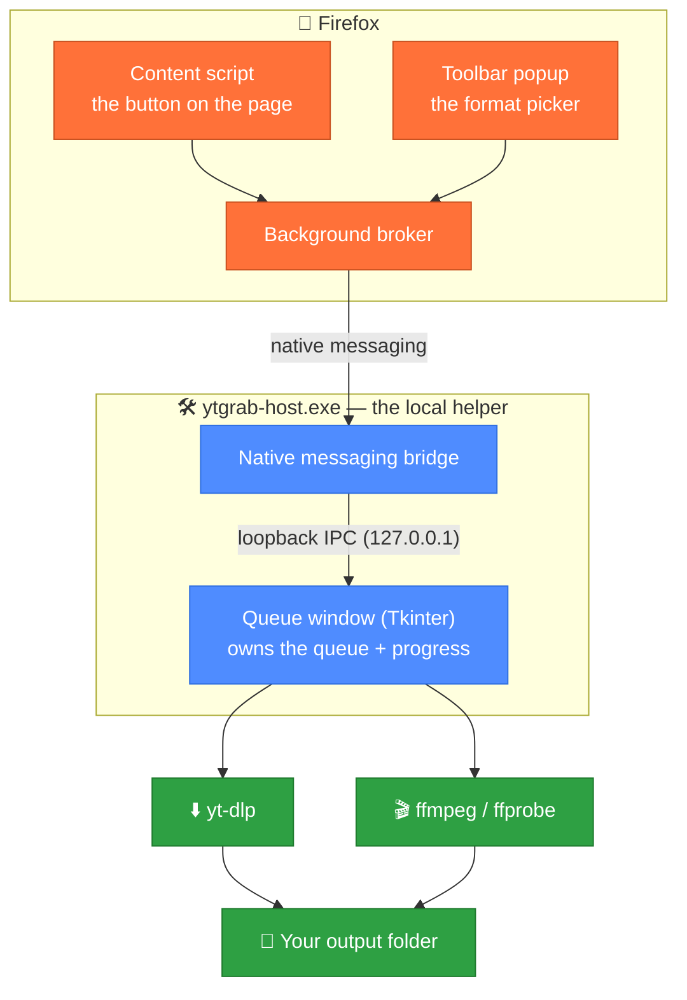

<div align="center">


# completeYtDownloader

**Download YouTube videos straight into Premiere Pro — from a button on the page.**

A tiny Firefox extension, a small local helper, and no needless re-encoding.

> **One name, two spellings.** Anything you *read* — the add-on entry, the popup
> header, the queue window — says **completeYtDownloader**. Anything you *type*
> is still `ytgrab`: the command, `ytgrab.exe`, the `%LOCALAPPDATA%\ytgrab`
> folder, the registry key and the add-on ID all kept their original names, so
> copies that are already installed keep updating themselves.

[](https://github.com/KSEE-btw/completeYtDownloader/releases/latest)
[](https://github.com/KSEE-btw/completeYtDownloader/releases)
[](#requirements)
[](#requirements)
[](#install)
[](#updating)

</div>

---

**completeYtDownloader** puts a format picker right on the video page. You choose a stream,
the download lands in a queue you can pause and resume, and the file that comes
out is one **Premiere Pro opens directly** — converted only when its codecs
actually make that necessary.

It works on **any site yt-dlp understands**, not just YouTube.

<a id="contents"></a>

## 📖 Contents

| | |
| --- | --- |
| 🎬 [What it is](#what-it-is) | ✨ [Highlights](#highlights) |
| ⚡ [Quick start](#quick-start) | 🧭 [How it works](#how-it-works) |
| 🎯 [Convert only when needed](#convert) | 📥 [Install, step by step](#install) |
| 🖱️ [Using it](#using-it) | 🪟 [The queue window](#queue-window) |
| 🎞️ [The editor pack](#editor-pack) | ✅ [Requirements](#requirements) |
| 🦊 [Why Firefox only](#browser-support) | 🔄 [Keeping it up to date](#updating) |
| ⚙️ [Settings](#settings) | 🗂️ [Where things live](#files) |
| 🧑‍💻 [Development](#development) | 🚧 [Roadmap](#roadmap) |
| 📦 [Sharing it](#share) | 🗑️ [Uninstall](#uninstall) |
| 🩺 [Troubleshooting](#troubleshooting) | ❓ [FAQ](#faq) |

<a id="what-it-is"></a>

## 🎬 What it is

Two pieces, working together:

- 🧩 **A Firefox extension** — the button on the page, the toolbar popup, the
  format list. This is what you actually look at.
- 🛠️ **A local helper** (`ytgrab-host.exe`) — a small program on your PC that
  does the work: it runs `yt-dlp` to download and `ffmpeg` to convert, and it
  owns the **queue window** where downloads live and show their progress.

A browser extension is not allowed to launch `yt-dlp` itself, which is why
there are two pieces and a one-time install rather than a single "Add to
Firefox" click. The helper is registered with Firefox through its normal
[Native messaging](https://developer.mozilla.org/docs/Mozilla/Add-ons/WebExtensions/Native_messaging)
channel — no administrator rights, nothing running as a service, no browser
hacked open.

### The problem it solves

Grab a 1440p or 4K video and YouTube hands you **VP9 or AV1**, which Premiere
will not touch. Most downloaders "solve" that by re-encoding everything — so
even a plain 1080p video that was already H.264 + AAC gets torn apart and put
back together for no reason, taking minutes and losing quality.

completeYtDownloader does the opposite:

- at **1080p**, YouTube serves H.264 + AAC in an MP4 → completeYtDownloader downloads it and
  **does not convert anything**;
- if you pick VP9/AV1/Opus → it **converts to a Premiere-friendly file** on the
  way to disk (H.264/AAC MP4, DNxHR or ProRes);
- if the codecs are fine but the container is not (H.264 inside an MKV) → it
  **remuxes in seconds** instead of re-encoding.

<a id="highlights"></a>

## ✨ Highlights

| | |
| --- | --- |
| 🖱️ **One click on the page** | A floating button on videos, plus a toolbar popup that accepts any URL yt-dlp understands. |
| 🏷️ **Formats labelled honestly** | Every entry is tagged `Premiere ✓`, `repack` or `convert`, so you can see the cost before you click. |
| 🎯 **Converts only when needed** | The download is finished, *then* `ffprobe` inspects the real file and decides. The checkbox says "if needed" because it means it. |
| 🪟 **A real download queue** | Runs in its own little window, so closing the popup — or Firefox — never interrupts a download. |
| ⏸️ **Pause, resume, retry, reorder** | Pausing keeps the part file; resuming carries on instead of starting over. |
| ⚡ **Parallel downloads** | Several whole videos at once (you choose how many) on top of yt-dlp's fragment-level parallelism. |
| 🎞️ **An editor pack** | Clip to a range, force constant frame rate, force 48 kHz audio — the three fixes cutting footage usually needs. |
| 🔒 **No account, no telemetry, no store** | It talks to YouTube (via yt-dlp) and to GitHub (for updates). Nothing else, nobody watching. |
| 🔄 **Updates itself** | The helper updates from GitHub releases; the extension updates the way any Firefox add-on does. |

<a id="quick-start"></a>

## ⚡ Quick start

### 🎁 Just want to use it? Grab the release bundle

1. **Download** the newest `ytgrab-<version>-windows.zip` from the
   [releases page](https://github.com/KSEE-btw/completeYtDownloader/releases/latest).
2. **Unzip it** anywhere — Desktop is fine. You do not need to keep the folder
   afterwards.
3. **Run the installer** in that folder:

   ```powershell
   powershell -ExecutionPolicy Bypass -File setup.ps1
   ```

4. **Click the blue arrow** on any video page. Done.

The installer is a conversation, not a black box: it walks through yt-dlp,
ffmpeg, the local helper and the extension, **detects and skips whatever you
already have**, and asks before it downloads anything. No administrator rights,
and running it again is always safe.

### 🧑‍💻 Working from a checkout instead?

```powershell
cd completeYtDownloader
powershell -ExecutionPolicy Bypass -File scripts\setup.ps1
```

Same installer; it builds the helper from source, so this path wants Python 3.9+
(see [Requirements](#requirements)).

### 🤖 No prompts, please

```powershell
scripts\setup.ps1 -Yes -Browser firefox
```

Everything is documented further down, step by step, if you would rather do it
by hand or understand what the installer did.

<a id="how-it-works"></a>

## 🧭 How it works



<details>
<summary>Diagram as plain text (for readers that don't render Mermaid)</summary>

```
┌──────────────────────── Firefox ─────────────────────────┐
│  content script  ─┐                                       │
│  toolbar popup   ─┼─▶ background broker ─ native ───▶      │  ytgrab-host.exe
└───────────────────┘      (ports)       messaging      ────┘   (messaging bridge)
                                                                       │
                                                                   loopback IPC
                                                                       │
                                                       ┌───────────────▼──────────────────────────────┐
                                                       │  completeYtDownloader queue window (Tkinter) │
                                                       │  owns the queue + progress                   │
                                                       └───────────────┬──────────────────────────────┘
                                                                       │
                                                             yt-dlp ───┴─── ffmpeg
```

</details>

The helper is a **bridge, not the worker**: it hands each job to the queue
window, and the queue window is what actually downloads, probes and converts.
That split is why closing the popup — or shutting the whole browser — never
interrupts a download.

The queue window is the *same* executable in another mode
(`ytgrab-host.exe --ui`), so there is still only one file to build and install.

<a id="convert"></a>

## 🎯 "Convert only when needed", in detail

1. **List and classify.** The helper runs `yt-dlp -J` and buckets every stream:

   | tag | meaning | what happens |
   | --- | --- | --- |
   | `Premiere ✓` | H.264/HEVC video + AAC/MP3/PCM audio in MP4/MOV | imported directly, nothing runs |
   | `repack` | right codecs, wrong container (e.g. H.264 in MKV) | remuxed in seconds, no re-encode |
   | `convert` | VP9 / AV1 / Opus / Vorbis | a real re-encode |

2. **Download.** With the *Auto — best Premiere-safe* entry selected, completeYtDownloader
   takes the best **H.264 + AAC** stream on offer, which is what the common
   1080p case has — so that case never converts.

3. **Verify, then convert.** After the download, `ffprobe` inspects the *actual
   file*. Only if its codecs are not Premiere-friendly does ffmpeg run. The
   checkbox just says "if needed" because that is genuinely all it does.

Conversion targets: **H.264/AAC MP4** (the default), **DNxHR HQ/PCM MOV**,
**ProRes 422 HQ/PCM MOV**.

<a id="install"></a>

## 📥 Install, step by step

The installer does four things, each one opt-in and skippable. Here they are by
hand, so you can see exactly what it touches. (Bundles ship the helper as a
finished `.exe`, so end users need no Python at all.)

### 1️⃣ yt-dlp — the thing that downloads

```powershell
winget install yt-dlp.yt-dlp
```

### 2️⃣ ffmpeg — the thing that converts

```powershell
winget install Gyan.FFmpeg
```

It brings `ffmpeg` and `ffprobe`. Both must end up on your `PATH`.

### 3️⃣ The local helper (once per machine)

**From a release bundle** (the exe is already there):

```powershell
powershell -ExecutionPolicy Bypass -File install.ps1
```

**From a checkout** (builds the exes first):

```powershell
cd completeYtDownloader
# builds host\dist\ytgrab-host.exe (helper + queue window)
#    and host\dist\ytgrab.exe      (the console CLI), installs both,
#    and registers the host with Firefox
powershell -ExecutionPolicy Bypass -File scripts\build_host.ps1
```

Either way the helper is copied to `%LOCALAPPDATA%\ytgrab`, its
native-messaging manifest is written there, and one registry key is added:

```
HKCU\Software\Mozilla\NativeMessagingHosts\ytgrab
```

**No administrator rights.** It keeps working if you later move or delete the
folder you installed from.

Missing `yt-dlp`/`ffmpeg`? Let the installer fetch them:

```powershell
powershell -ExecutionPolicy Bypass -File scripts\install.ps1 -InstallDeps
```

> No exe builder handy? Plain `scripts\install.ps1` falls back to a `pythonw`
> launcher, so the helper still runs straight from the Python source.

### 4️⃣ The extension

**For a quick trial** (this vanishes the moment Firefox quits):

1. Open `about:debugging#/runtime/this-firefox`
2. **Load Temporary Add-on…** → pick `extension/manifest.json`
3. Open any video — click the blue arrow button at the bottom right.

**Permanently** — a release bundle already contains a Mozilla-signed `.xpi`;
install it and you are done:

- **about:addons** → gear icon (top right) → **Install Add-on From File…** →
  pick `ytgrab-<version>.xpi`, **or**
- drag the `.xpi` straight into a Firefox window and confirm.

From then on it loads at every start like any other add-on, and updates itself
(see [Keeping it up to date](#updating)).

<details>
<summary><strong>Signing it yourself</strong> (only needed if you build your own <code>.xpi</code>)</summary>

Release Firefox will only keep an add-on permanently if **Mozilla has signed
it** — that is a Firefox security rule, not a completeYtDownloader limitation. Signing is free
and publishes nothing unless you ask it to.

Once per machine, grab API credentials from
<https://addons.mozilla.org/developers/addon/api/key/> (they look like
`user:12345:67` and a long hex string), then:

```powershell
$env:AMO_JWT_ISSUER = 'user:12345:67'
$env:AMO_JWT_SECRET = 'deadbeef…'

powershell -ExecutionPolicy Bypass -File scripts\package.ps1 -Sign
```

That lints the add-on with the same validator AMO uses, builds it, and uploads
it for **unlisted** (self-distribution) signing, writing
`web-ext-artifacts\ytgrab-<version>.xpi`.

> AMO refuses a version number it has already seen, so pass `-BumpPatch`
> (`scripts\package.ps1 -Sign -BumpPatch`) when re-releasing.

**Rather not sign?** On **Firefox Developer Edition, Nightly or ESR** you can
run an unsigned build permanently: set `xpinstall.signatures.required` to
`false` in `about:config`, then install
`web-ext-artifacts\ytgrab-<version>-unsigned.xpi`. The preference is **ignored
on regular Firefox**, so this is not an option there.

</details>

<a id="using-it"></a>

## 🖱️ Using it

The floating button appears on video pages; the **toolbar icon works
anywhere** — paste any URL yt-dlp understands, not just YouTube.

1. **Pick a format.** Each entry is tagged `Premiere ✓`, `repack` or `convert`.
   Leave it on *Auto — best Premiere-safe* if you just want a file Premiere
   opens.
2. **Choose where files land** with the **…** button in the **Save to** bar.
   Pick a folder once and completeYtDownloader remembers it.
3. **Leave "Convert to a Premiere-compatible file — only if needed" ticked**
   and choose a target codec — or untick it to keep the original bytes exactly
   as they came.
4. **Download** hands the job to the queue window; the panel confirms *"Added
   to the queue"*. Use **Open queue window** to watch it.

<a id="queue-window"></a>

### 🪟 The queue window

Downloads run in a small desktop window rather than inside the popup, which is
what makes them survive closing either one.

- Each row shows the title, live status, a progress bar, speed and ETA, plus
  **Cancel** / **Pause** / **Resume** / **Retry** / **Remove** / **Show file**
  as appropriate, and **▲ ▼** to move a waiting item up or down the queue.
- **Several downloads at once.** The **Downloading _n_ at once** picker at the
  top sets how many run in parallel — 2 by default, up to 8. (The fragments
  *inside* one file are already downloaded in parallel; this is about whole
  videos.) The queue stays first-in-first-out whatever you choose.
- **Pause** stops a download and keeps the part file, so **Resume** carries on
  where it left off instead of starting over. **Pause all** / **Resume all**
  hold and release the whole queue.
- **Tick boxes** on the left pick several rows; **Cancel selected** and
  **Remove selected** then act on all of them at once.
- **Closing the window keeps everything running** — it minimises to the
  taskbar. Reopen it from **Open queue window**, or by running
  `%LOCALAPPDATA%\ytgrab\ytgrab-host.exe --ui`.
- **Quit** (in the window, or `Ctrl+Q`) stops completeYtDownloader. Unfinished items are saved
  and **resume the next time the window starts**; finished items stay as
  history.
- The **Save to** bar shows where downloads land; **Change…** opens the folder
  picker and remembers the choice, **Open folder** jumps there, and **Clear
  finished** tidies the history away.

The queue lives in `~/.config/ytgrab/queue.json`. Deleting it just forgets the
history — no download is harmed.

<a id="editor-pack"></a>

### 🎞️ The editor pack

Three extras for footage you are about to cut, in the popup's **Clip** row and
the two boxes under it:

- ✂️ **Clip** — fill in a start, an end, or both (`1:30`, `0:01:30`, or plain
  seconds) to download just that stretch. yt-dlp fetches only the fragments
  that cover the range, so grabbing 40 seconds out of a two-hour stream does
  not pull two hours, and a keyframe is forced at each cut so the in/out points
  land where you asked. Leave both blank for the whole video. While it cuts, the
  row counts up with a live percentage and ETA; a clip with **no end** has no
  known length, so its bar spins instead.
- 🎞️ **Constant FPS** — rebuilds the video at a constant frame rate when the
  source is variable (phones and screen capture, mostly) — the fix for footage
  that drifts a few frames out of sync by the end of a long clip. Sources that
  are already constant are left alone.
- 🔊 **48 kHz audio** — re-encodes the audio at 48 kHz, the rate editing tools
  mix at. A stream copy cannot change the sample rate, so this rewrites the
  audio only and leaves the video untouched when the codecs are otherwise fine.

Both boxes work with conversion switched off as well — they are explicit asks,
so they win over the "already compatible" shortcut. The clip range is applied
while downloading, so it works either way.

<a id="requirements"></a>

## ✅ Requirements

| | |
| --- | --- |
| 🖥️ **Windows** | 10 or 11 |
| 🦊 **Firefox** | 115 or newer |
| ⬇️ **yt-dlp** | on `PATH` — `winget install yt-dlp.yt-dlp` |
| 🎬 **ffmpeg + ffprobe** | on `PATH` — `winget install Gyan.FFmpeg` |
| 🐍 **Python 3.9+** | **only** when building the helper from a checkout. A release bundle ships a standalone `.exe`, so end users need no Python. The queue window uses Tkinter, which comes with the python.org installer. |
| 🟢 **Node 18+** | **only** to package or sign the extension (`web-ext`) |

<a id="browser-support"></a>

## 🦊 Firefox only — and why

That is deliberate, not an oversight.

Chrome, Edge, Brave, Vivaldi and Opera would each need a **separate build**: a
service-worker background script instead of `background.scripts`, `chrome.*`
handlers instead of promise-returning `browser.*`, PNG icons, a pinned extension
ID, and their own native-messaging origins and registry keys.

On top of that, with no store listing a *permanent* Chromium install means an
enterprise policy or Developer Mode — and Developer Mode greets you with a
"disable developer mode extensions" prompt on every single launch. Firefox
installs the signed `.xpi` with one click.

The interactive installer detects the other browsers on your PC and says so,
rather than pretending they are supported.

<a id="updating"></a>

## 🔄 Keeping it up to date

The installer puts a small command-line tool on your `PATH`, next to the helper:

```powershell
ytgrab update           # check, download, verify, install, then show what changed
ytgrab update --check   # just report whether a newer version exists
ytgrab notes            # (re)print the notes for the version you have
ytgrab version          # print the installed versions and folders
ytgrab ui               # open (or focus) the download queue window
ytgrab config           # show every stored setting
ytgrab config KEY VAL   # change one, e.g. cookies_from_browser chrome
```

`ytgrab update` reads the newest
[GitHub release](https://github.com/KSEE-btw/completeYtDownloader/releases), compares it
with the version recorded in `%LOCALAPPDATA%\ytgrab\version.txt`, asks before it
changes anything (add `--yes` to skip the prompt), downloads the bundle,
**checks its SHA-256** against the published `SHA256SUMS.txt`, and only then
swaps the executables. If the queue window is running it is stopped first, and
anything unfinished resumes afterwards. The backup of the exe that replaced
itself is cleaned up on the next run.

The **extension** updates the way any Firefox add-on does: the signed build
declares a `gecko.update_url` pointing at
[`docs/updates.json`](docs/updates.json), and the release workflow refreshes
that file from each new signed release. So `ytgrab update` is only ever needed
for the local helper — the add-on looks after itself. To nudge it, use
**about:addons → gear → Check for Updates**.

<a id="settings"></a>

## ⚙️ Settings

Stored in `~/.config/ytgrab/config.json` (created on first write; see
[`config.example.json`](config.example.json)). Change any of them with
`ytgrab config KEY VALUE`, or from the UI where a control exists.

### General

| key | meaning |
| --- | --- |
| `outdir` | where finished files go — set it with the **…** button beside **Save to** (or **Change…** in the queue window). Default: your `Downloads` folder |
| `default_mode` | `premiere_safe` or `best` for the *Auto* entry |
| `default_target` | `h264`, `dnxhr` or `prores` |
| `keep_original` | keep the non-Premiere source after converting |
| `ensure_audio` | when a picked format is video-only, also fetch the best audio and mux it in (default `true`, so nothing lands silent) |
| `cookies_from_browser` | browser to borrow cookies from: `auto` (Firefox — the default), `firefox`, `chrome`, `edge`, `brave`, … or `none`. Clears YouTube's "confirm you're not a bot" wall |
| `force_no_playlist` | refuse playlist URLs instead of grabbing the whole thing (default `true`) |
| `extra_ytdlp_args` | extra raw yt-dlp flags |
| `ui_theme` | `auto`, `light` or `dark` — `auto` follows the Windows app theme; the queue window's toggle writes your choice here |
| `ytdlp` / `ffmpeg` / `ffprobe` / `aria2c` | explicit binary paths (default: find on `PATH`) |

### Editor pack

| key | meaning |
| --- | --- |
| `clip_start` / `clip_end` | default clip range the popup pre-fills (`""` = the whole video) |
| `force_cfr` | default for the **Constant FPS** box (default `false`) |
| `audio_48k` | default for the **48 kHz audio** box (default `false`) |

### Speed

Everything below is **quality-neutral** by default — none of it changes the
pixels that come out.

| setting | default | what it does |
| --- | --- | --- |
| `concurrent_fragments` | `8` | download DASH fragments in parallel (`-N`); the biggest win on segmented sites like YouTube |
| `max_concurrent` | `2` | how many *whole* videos download at once (1–8). Also set live by the queue window's **Downloading _n_ at once** picker |
| `use_aria2c` | `auto` | if [aria2c](https://aria2.github.io/) is on `PATH`, use 16 connections per file |
| `http_chunk_size` | `""` | split HTTP ranges to beat throttling (e.g. `10M`); off by default |
| `hwaccel` | `true` | decode with the GPU; falls back to CPU automatically if the codec is not supported |
| `x264_preset` | `faster` | x264 speed/size trade-off. At a fixed CRF the preset does **not** change quality, only encoding time and file size |
| `x264_crf` | `18` | quality target (lower = better/bigger). `18` is visually lossless |
| `video_encoder` | `libx264` | `h264_nvenc` / `h264_qsv` / `h264_amf` are much faster but slightly less efficient per bitrate — opt in only if you want the speed |

Two more things the helper does automatically:

- **No double copy.** The download lands in a scratch folder *inside* the
  output directory, so publishing the finished file is a rename, not a second
  full write. A 4K download therefore never needs twice the disk space.
- **Audio is stream-copied, not re-encoded**, whenever the source audio is
  already AAC/MP3 and the target is MP4. Instant, and no generation loss.

The real fastest path is to not convert at all: the *Auto — best Premiere-safe*
entry picks H.264/AAC, which almost every 1080p video offers.

<a id="files"></a>

## 🗂️ Where things live

| what | where |
| --- | --- |
| The helper and the CLI | `%LOCALAPPDATA%\ytgrab` (with `version.txt` and the shipped `RELEASE-NOTES.md`) |
| Firefox's registration | `HKCU\Software\Mozilla\NativeMessagingHosts\ytgrab` |
| Your settings | `~/.config/ytgrab/config.json` |
| The queue and its history | `~/.config/ytgrab/queue.json` |
| Finished downloads | `outdir` — your `Downloads` folder until you change it |
| The repo checkout | only needed for development; the installed helper does not depend on it |

Debug output goes to `stderr` and is off by default — set `YTGRAB_DEBUG=1` to
get a running commentary from the helper, the queue window or the CLI.

<a id="development"></a>

## 🧑‍💻 Development

The code is a layered package under `src\ytgrab\`:

| package | role |
| --- | --- |
| `domain\` | pure logic: codec and container rules, format classification, editor maths, progress parsing |
| `services\` | the work: the download pipeline, the queue engine, the job model, the command layer, releases |
| `infrastructure\` | the outside world: config, tool discovery, subprocesses, loopback IPC, native messaging, install/update, HTTP |
| `presentation\ui\` | the Tkinter queue window, theme and widget helpers |
| `presentation\cli\` | the console CLI (`update`, `notes`, `version`, `config`, `ui`) |
| `entrypoints\` | the two frozen executables: `host.py` and `cli.py` |

Dependencies point one way — `presentation` and `services` use
`infrastructure`, which uses `domain`. Everything below assumes `src` is
importable (from the repo root: `$env:PYTHONPATH = "$PWD\src"`).

```powershell
python -m ytgrab.entrypoints.host --ping           # tools + config
python -m ytgrab.entrypoints.host --list "URL"     # raw format JSON
python scripts\show_formats.py "URL"               # pretty format table
python scripts\test_host.py "URL"                  # talk the native protocol
python scripts\test_host.py ui                     # ask the host to open the window
python -m ytgrab.entrypoints.host --ui             # open the queue window directly
python -m ytgrab.entrypoints.host --headless       # run the queue with no window
python -m ytgrab.entrypoints.host --smoke          # build + destroy the window (what CI runs)
python -m ytgrab.entrypoints.host --self-test-url "URL"   # queue -> download
python -m ytgrab.entrypoints.cli --help            # the console CLI
python scripts\check_versions.py                   # version parity + notes check
```

The regression suites live in `tests\` and run in CI:

```powershell
python tests\run_all.py        # the offline suites
python tests\run_all.py --net  # add the ones that download from YouTube
```

`scripts\test_host.py` speaks the real native-messaging framing, so it exercises
exactly what Firefox does without opening a browser. A `download` returns a
short `queued` reply instead of streaming progress.

### Cutting a release

One document feeds everything: `docs/releases/vX.Y.Z.md` is added in the commit
that makes the change, becomes the body of the GitHub release, ships inside the
bundle as `RELEASE-NOTES.md`, and is what `ytgrab update` prints. A CI check
([`scripts/check_versions.py`](scripts/check_versions.py)) keeps the manifest
version, the package version and that file in step, and the workflow in
[`.github/workflows/`](.github/workflows/) builds, signs and publishes on a
`v*` tag.

<a id="roadmap"></a>

## 🚧 Roadmap

| | what | status |
| --- | --- | --- |
| 1 | Parallel downloads + queue control (pause/resume, reorder, bulk actions) | ✅ shipped |
| 2 | Editor pack — clip range, constant FPS, 48 kHz audio | ✅ shipped |
| 3 | Playlists, pasting several links at once, skipping what you already have | 🚧 next |
| 4 | Download history, notifications and a tray icon | 📋 planned |
| 5 | `ytgrab doctor` — a one-command health check | 📋 planned |
| 6 | Proxy support, speed limits and scheduled downloads | 📋 planned |

No dates — this is a spare-time project. Playlist URLs are refused rather than
half-supported until item 3 lands (`force_no_playlist`).

<a id="share"></a>

## 📦 Share it with someone else

One command produces a self-contained bundle:

```powershell
powershell -ExecutionPolicy Bypass -File scripts\make_release.ps1 -Sign
```

That writes `release\ytgrab-<version>-windows.zip` containing both executables
(`ytgrab-host.exe` for the helper and queue window, `ytgrab.exe` for the CLI),
`install.ps1` / `uninstall.ps1`, the signed `.xpi`, `RELEASE-NOTES.md` and a
`READ-ME-FIRST.txt` — plus `release\SHA256SUMS.txt` and `release\updates.json`
beside the zip, which the updater and Firefox respectively consume. Hand the zip
to anyone, or attach it to a GitHub Release; their steps are the three in
[Quick start](#quick-start).

The repo also ships [`.github/workflows/release.yml`](.github/workflows/release.yml),
which runs exactly this on a `v*` tag, uses `docs/releases/v<version>.md` as the
release body, attaches the zip, the checksums and the signed `.xpi`, and
refreshes `docs/updates.json` on `main` for Firefox auto-update. Add
`AMO_JWT_ISSUER` and `AMO_JWT_SECRET` as repository secrets and the CI build is
signed too.

Two things worth knowing when you hand this out:

- **Everyone shares one extension ID.** The `.xpi` is `ytgrab@kunal.local` (from
  `extension/manifest.json`), and the installer allows exactly that ID. Re-sign
  the same ID for updates — don't change it, or installed copies stop talking to
  the helper.
- **The local helper cannot be avoided.** A browser extension is not allowed to
  run `yt-dlp`, so a helper plus one registry entry are required. That is why
  install is a two-step (helper, then extension) rather than a single "Add to
  Firefox" click.

Want it discoverable and one-click instead? Publish it publicly: set
`sign.channel` to `listed` in `.web-ext-config.mjs` and run
`npx web-ext sign --channel listed` (needs a first-listing metadata file — see
the [web-ext docs](https://extensionworkshop.com/documentation/develop/getting-started-with-web-ext/)).
The helper installer still has to be distributed alongside it.

<a id="uninstall"></a>

## 🗑️ Uninstall

```powershell
powershell -ExecutionPolicy Bypass -File scripts\uninstall.ps1
```

Removes the registry key and the copy under `%LOCALAPPDATA%\ytgrab`. Add
`-Purge` to also delete your saved settings (`~/.config/ytgrab`), or `-Deep` to
also scrub the bookkeeping a *temporary* add-on leaves in your Firefox profile
(close Firefox first; `prefs.js` is backed up before it is touched).

The extension itself goes away inside Firefox: a permanent install in
**about:addons**, a temporary one the moment Firefox restarts.

<a id="troubleshooting"></a>

## 🩺 Troubleshooting

- **The badge says "host offline"** — re-run the installer, then restart
  Firefox. Check the key exists:
  `Get-ItemProperty HKCU:\Software\Mozilla\NativeMessagingHosts\ytgrab`
- **"tools missing"** — `yt-dlp`/`ffmpeg` are not on the `PATH` Firefox sees.
  Run `scripts\install.ps1 -InstallDeps`, or set explicit paths in the config.
  (The helper also reads the saved `PATH` from the registry, so a tool installed
  moments ago is found without restarting Firefox.)
- **"Sign in to confirm you're not a bot"** — YouTube wants a signed-in session.
  completeYtDownloader reuses browser cookies (`cookies_from_browser`, default `auto` =
  Firefox). Point it at the browser you are signed into YouTube with:
  `ytgrab config cookies_from_browser chrome` (or `firefox`, `edge`, `brave`,
  `none`). A newer yt-dlp helps too.
- **Nothing appears on the page** — the extension must be loaded in
  `about:debugging` or installed permanently; check the browser console for a
  completeYtDownloader error.
- **Firefox refuses the `.xpi`** ("could not be installed because it is not
  verified") — that is the unsigned build. Sign it
  (`scripts\package.ps1 -Sign`) or switch to Firefox Developer Edition.
- **A signed install will not update** — bump the version first:
  `scripts\package.ps1 -Sign -BumpPatch`.
- **`web-ext` complains about Node** — this repo pins `web-ext@8` (Node 18+).
  web-ext 10 needs Node 20; upgrade Node or keep the pin.

<a id="faq"></a>

## ❓ FAQ

<details>
<summary><strong>Do I need to know PowerShell or keep the repo around?</strong></summary>

No. The installer is a series of yes/no prompts, and it copies everything it
needs into `%LOCALAPPDATA%\ytgrab`. Once it has run you can delete the folder
you installed from. The `ytgrab` command stays on your `PATH` for updates.
</details>

<details>
<summary><strong>Where do my files go?</strong></summary>

To `outdir`, which starts as your `Downloads` folder. Change it with the **…**
button next to **Save to** in the popup, **Change…** in the queue window, or
`ytgrab config outdir "D:\Footage"`.
</details>

<details>
<summary><strong>Does anything get sent anywhere?</strong></summary>

No telemetry and no account. The helper talks to YouTube (through yt-dlp) and
to GitHub — only to check for and fetch updates. Your settings never leave the
machine. Updates are self-hosted on GitHub Releases rather than routed through
Mozilla.
</details>

<details>
<summary><strong>Why does a clip take as long as the clip?</strong></summary>

Cutting a clip forces a keyframe at each end, so ffmpeg re-encodes the section —
roughly 1× realtime on 1080p60 footage. That is what makes a 20-second clip take
about 20 seconds; the queue row now shows exactly where it is instead of sitting
at zero. A full download is not re-encoded this way.
</details>

<details>
<summary><strong>Can I download a playlist?</strong></summary>

Not yet — playlist URLs are refused on purpose rather than half-supported.
Playlists, pasting several links at once and skipping files you already have are
[roadmap item 3](#roadmap).
</details>

<details>
<summary><strong>Will it convert my 1080p video for no reason?</strong></summary>

It should not: at 1080p YouTube offers H.264 + AAC in an MP4, so completeYtDownloader
downloads it, verifies it, and stops. Conversion only happens for streams that
Premiere cannot read (VP9/AV1/Opus) or when you explicitly ask for a target like
ProRes or DNxHR.
</details>

<details>
<summary><strong>Can it run in the background / when Firefox is closed?</strong></summary>

The queue window keeps working while it is open, and deleting or closing the
popup never interrupts it. Closing the *window* only minimises it to the
taskbar. Quitting the window stops completeYtDownloader, but unfinished items are saved and
resume next time; a tray icon that keeps it alive quietly is
[roadmap item 4](#roadmap).
</details>

<details>
<summary><strong>Why is <code>ytgrab-host.exe</code> so big?</strong></summary>

It is a standalone Python build (PyInstaller) with Tkinter inside, so it carries
its own interpreter — that is what lets end users run it with no Python
installed. The CLI (`ytgrab.exe`) is a separate, smaller build without Tkinter.
</details>

---

<div align="center">

Built for one workflow: **grab it, cut it, don't re-encode it.**

[Report a bug](https://github.com/KSEE-btw/completeYtDownloader/issues) · [Releases](https://github.com/KSEE-btw/completeYtDownloader/releases) · [Release notes](docs/releases)

</div>
